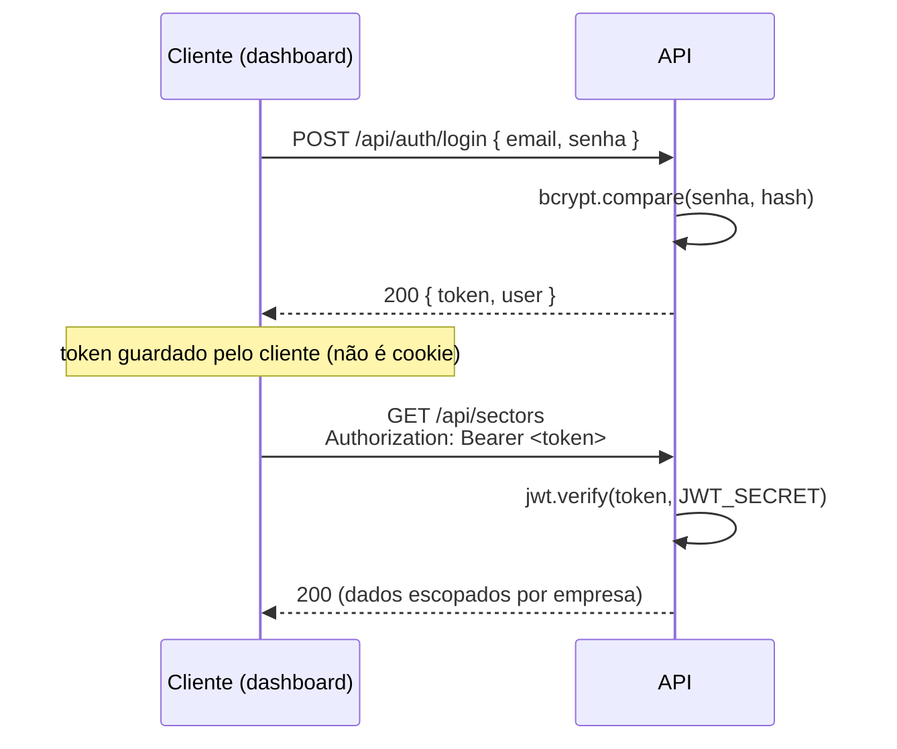

# Autenticação e Autorização

O sistema tem **dois mecanismos de autenticação independentes**, para dois tipos de cliente completamente diferentes:

| | Usuário do dashboard | Dispositivo ESP32 |
| --- | --- | --- |
| Credencial | e-mail + senha → JWT | `token` fixo gerado no cadastro |
| Header | `Authorization: Bearer <jwt>` | `X-Token: <token>` |
| Middleware | [`authenticateUser`](../src/middlewares/auth.middleware.ts) | [`authenticateDevice`](../src/middlewares/auth.middleware.ts) |
| Usado em | quase todas as rotas de `/api` | leituras, identificação e confirmação de persistência |
| Identifica | uma pessoa, com papel (`tipo`) e empresa | um ESP32 específico, com setor |

Os dois nunca se misturam na mesma rota — ver a lista completa em [API.md](./API.md#catálogo-de-endpoints).

## Autenticação de usuário (JWT)



- O token é assinado com `HS256` (padrão da lib `jsonwebtoken`), segredo em `JWT_SECRET`, validade em `JWT_EXPIRES_IN` (default `8h`).
- **Payload do JWT** (visível — JWT não é criptografado, só assinado; nunca coloque dado sensível aqui):
  ```json
  { "id": 2, "email": "carla.mendes@aquaplas.com", "tipo": "GESTOR", "empresaId": 1, "iat": ..., "exp": ... }
  ```
- `authenticateUser` (em [`auth.middleware.ts`](../src/middlewares/auth.middleware.ts)) lê o header `Authorization`, exige o prefixo `Bearer `, valida assinatura e expiração, consulta o usuário no banco e popula `req.user` com os dados atuais. Token inválido/expirado ou usuário removido retorna `401`; usuário inativo retorna `403`.
- Não há armazenamento de sessão no servidor: é um JWT stateless clássico. O logout descarta o token no cliente. Em cada requisição protegida, o back-end consulta o usuário atual para aplicar status, papel e empresa vigentes; usuários excluídos ou inativos são bloqueados e alterações de papel/empresa têm efeito imediato. Não há blacklist nem revogação geral por troca de senha — ver [SECURITY.md](./SECURITY.md#tokens-jwt-sem-revogação).

## Autorização por papel (roles)

Três papéis, definidos na coluna `usuario.tipo`, com status `ATIVO|INATIVO` (inativo não faz login — `403 FORBIDDEN` — e é barrado em recursos protegidos):

| Papel | Escopo | O que só ele pode fazer |
| --- | --- | --- |
| `ADMIN` | global; vinculado à SIVA (`empresaId = SIVA.id`, sem especialidade) | CRUD de empresas; criar/editar/ativar/inativar/deletar usuários; aceitar/concluir OS e designar técnicos; dashboard admin |
| `GESTOR` | só a própria empresa cliente (`empresaId` obrigatório, sem especialidade) | CRUD de setores/ativos/ESP32s/sensores da empresa; manutenção interna; criar OS; leitura de usuários da própria empresa |
| `TECNICO` | **exclusivo da SIVA** (`Empresa.tipo = SIVA`) + especialidade `MECANICO\|ELETRICISTA` obrigatória | listar e visualizar somente as OS em que é o `funcionarioId` |

> Cadastro de usuários: empresa SIVA aceita `ADMIN` ou `TECNICO`; empresa cliente aceita somente `GESTOR`. Todo usuário pertence a uma empresa (inclusive o `ADMIN`). Combinações inválidas retornam `422`.

O `TECNICO` é bloqueado nos demais módulos pelo middleware `denyTecnico`
(users, companies, sectors, assets, devices, sensors, maintenances, alerts,
dashboard e `GET /readings`). Nas OS, o escopo não é por `empresaId`: o service
filtra `funcionarioId = usuário autenticado`, e o detalhe de OS de outro técnico
retorna `403`.

Aplicado em duas camadas, sempre nessa ordem:

1. **`authorize(...papéis)`** (middleware, por rota) — checagem grosseira, antes de tocar em qualquer dado: "esse papel pode nem tentar chegar aqui". Ex.: `sectorRoutes.post('/', authorize('ADMIN', 'GESTOR'), ...)`.
2. **`assertSameCompany(user, recurso.empresaId)`** (dentro do service, depois de já ter buscado o recurso) — checagem fina: "mesmo sendo `GESTOR`, isso é da empresa desse usuário?". Está em [`shared/auth/scope.ts`](../src/shared/auth/scope.ts):
   ```ts
   export function assertSameCompany(user: AuthenticatedUser, empresaId: number | null): void {
     if (isAdmin(user)) return;
     if (user.empresaId === null || user.empresaId !== empresaId) {
       throw new ForbiddenError('Você não tem acesso aos dados desta empresa.');
     }
   }
   ```

Para recursos que não têm `empresaId` direto (ativo, ESP32, sensor, leitura, manutenção), a checagem "sobe" a cadeia da hierarquia até achar o setor e, a partir dele, a empresa — ver o diagrama em [ARCHITECTURE.md](./ARCHITECTURE.md#multi-tenant-como-o-isolamento-entre-empresas-é-aplicado).

## Autenticação de dispositivo

O ESP32 gera um segredo temporário e o apresenta por HTTPS em `X-Pairing-Secret`. O usuário aprova a associação entre sensor e ativo com o código do OLED. A placa retira a credencial, grava-a em NVS e confirma a gravação. O middleware de dispositivo verifica o hash do `X-Token` e o estado de revogação. O painel permite revogar a credencial mantendo o histórico do sensor. [Contrato e recuperação](PAREAMENTO_ESP32.md)

## Registro e troca de senha

- Não existe endpoint de **auto-registro**: usuários só são criados por um `ADMIN` via `POST /api/users` (ver regras em [BUSINESS_FLOWS.md](./BUSINESS_FLOWS.md#usuário)).
- Não existe fluxo de "esqueci minha senha" (envio de e-mail, token de reset). A única forma de trocar senha hoje é `PATCH /api/users/:id` (somente ADMIN) enviando o campo `senha`.
- 🚧 **Não implementado nesta etapa**: recuperação de senha por e-mail, MFA/2FA, refresh token (o cliente reloga quando o JWT expira).
